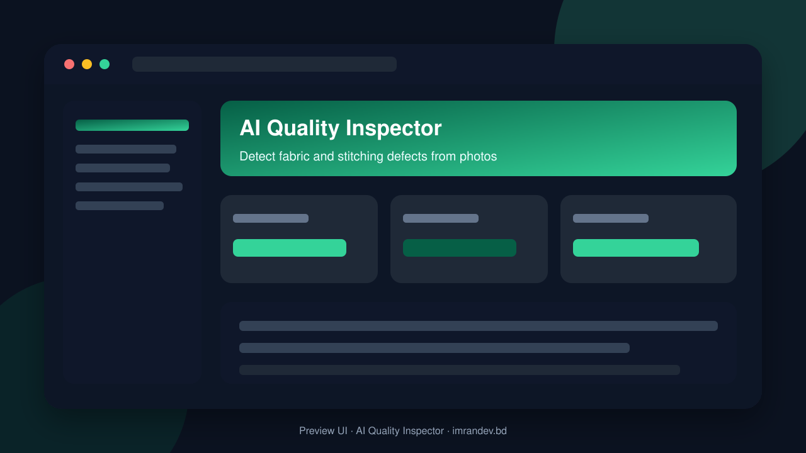
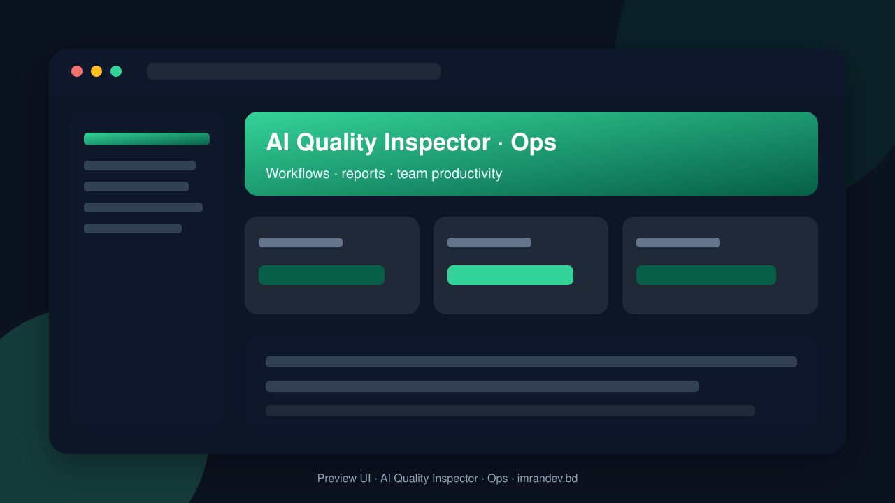

<p align="center">
  
</p>

# AI Quality Inspector

<p align="center"><strong>Detect fabric and stitching defects from photos</strong></p>

<p align="center">
  <a href="https://github.com/imranbru99/ai-quality-inspector-fabric-defects"></a>
  
  
</p>

---

## Overview

**AI Quality Inspector** — Detect fabric and stitching defects from photos.

This README documents the **real application features** so GitHub and Google visitors can understand what the product does.

## Product screenshots

| Dashboard | Operations |
| :---: | :---: |
|  |  |

## Application features

### AI visual QC

- Photo upload for fabric / stitching inspection
- AI defect detection and classification
- Severity scoring and reject / rework decisions
- Lot / style / factory QC batches
- Inspector review and override workflow
- Defect trend analytics by supplier/factory
- Evidence gallery linked to QC records
- Exportable QC reports for buyers

## Tech stack

- PHP 8.2+ / Laravel
- Filament admin (where enabled)
- Migrations, seeders, queues
- Vite asset pipeline
- MySQL / SQLite ready

## Quick start

```bash
git clone https://github.com/imranbru99/ai-quality-inspector-fabric-defects.git
cd ai-quality-inspector-fabric-defects
composer install
cp .env.example .env
php artisan key:generate
php artisan migrate --seed
npm install && npm run build
php artisan serve
```

## Author

**Imran Ahmed** · https://imrandev.bd · me@imrandev.bd  
GitHub: https://github.com/imranbru99/ai-quality-inspector-fabric-defects

---
## 🤝 Let's Connect & Collaborate

I am open to **Senior Remote Full-Stack Roles**, AI Platform Architecture Contracts, and Enterprise Technical Advisory.

| Channel | Link |
| :--- | :--- |
| Portfolio | https://imrandev.bd |
| GitHub | https://github.com/imranbru99 |
| LinkedIn | https://linkedin.com/in/imranbru99 |
| Email | me@imrandev.bd |
| WhatsApp | https://wa.me/8801576918420 |
| Packagist | https://packagist.org/packages/imrandevbd/ |

